# 🛡️ Neeshant (sudonishant)
### `18 Year Old | Security Researcher & Developer`

  

  <b>🎵 Profile Theme Song:</b> 
  <audio src="hacker_theme.mp3" controls></audio>

  

Welcome to my profile! I am a cyber security enthusiast focused on identifying security gaps, automation scripting, and operating system hardening. I specialize in ethical hacking, penetration testing, and security auditing.

---

### 💻 [LIVE INTERACTIVE WEB SHELL]
Want to run commands? Try my live interactive terminal simulator at:
👉 **[sudonishant.github.io](https://sudonishant.github.io/)**

---

### 🛠️ Technical Toolkit

#### 💻 Languages & Scripting

#### 🛡️ Auditing & System Tools

---

### 📫 Secure Communication
* 💬 Ask me about: **Web application vulnerabilities, basic Python scripting, and Linux configuration.**
* 📧 Email: You can contact me via my secure GitHub-provided email: `302756519+sudonishant@users.noreply.github.com`
* 🎮 Discord: `sudonishant`
* 💼 LinkedIn: `nishant-kumar-423870291`

---

> ⚠️ **Disclaimer:** All repositories, configurations, and tools shared on this profile are created strictly for **educational purposes, defensive security auditing, and authorized testing**. I do not condone, promote, or participate in any form of unauthorized access or malicious hacking activities.
