<div align="center">
  

  # 🛡️ Neeshant (sudonishant)
  ### `Cybersecurity Researcher | Systems Developer`

  <p>Building defensive security tools, resilient systems, and practical cross-platform software.</p>

  <p>
    <a href="https://www.neeshant.online/">
      
    </a>
    <a href="https://github.com/sudonishant">
      
    </a>
    <a href="https://linkedin.com/in/nishant-kumar-423870291">
      
    </a>
    <a href="mailto:sudonishant@gmail.com">
      
    </a>
  </p>

  
</div>

---

## What this repository contains

This repository is the source for the `sudonishant` GitHub profile README. It is a static profile page rather than an application or security toolkit: there is no executable source code, package manifest, service configuration, or automated test suite here. The committed files are the README and the visual/audio assets it references (`profile_avatar.png`, `hacker_console.svg`, and `hacker_theme.mp3`).

The terminal artwork is a fictional, defensive-themed visual for the profile page; its on-screen output is not a runnable scan, exploit, or proof of activity. Any security work described below should be understood as subject to authorization and applicable law.

### Preview locally

No build step is required. From the repository root, open `README.md` in a Markdown viewer that permits local images, or preview it with GitHub after publishing the branch. The external portfolio, interactive-terminal, badge, and telemetry links require network access and are not part of this repository.

There are currently no environment variables, setup commands, runtime entry points, or automated tests to configure or run.

### 🌐 About Me

I’m a cybersecurity researcher and software developer focused on defensive security, digital forensics, Linux hardening, and practical cross-platform applications.

- 🔭 **Areas of interest:** AI trust and safety, scam-prevention workflows, and digital-media forensics.
- 📱 **App development:** Building cross-platform applications with Flutter and Dart.
- 🛠️ **Systems and automation:** Linux, OSINT tooling, and automation with Python, Go, Bash, and C++.
- 🚀 **Portfolio:** Visit [neeshant.online](https://www.neeshant.online/) or explore my [interactive terminal project](https://neeshant.is-a.dev/).

---

### ⚡ Core Competencies

```text
[+] Security Research:       Authorized testing, threat modeling, defensive security
[+] Digital Investigations:  OSINT, scam triage, digital-media forensics
[+] Cross-Platform Apps:     Flutter, Dart, state management, native integrations
[+] Systems & Automation:    Linux hardening, Python, Go, Bash, C++
```

---

### 🛠️ Technical Stack & Tooling

#### 💻 Languages & Frameworks

<p>
  
  
  
  
  
  
  
  
</p>

#### 🛡️ Security, Systems & Tooling

<p>
  
  
  
  
  
  
  
</p>

---

### 📊 GitHub Telemetry

<div align="center">
  
  
</div>

---

### 📫 Connect & Secure Communication

- 🌐 **Portfolio:** [neeshant.online](https://www.neeshant.online/)
- 🖥️ **Interactive terminal:** [neeshant.is-a.dev](https://neeshant.is-a.dev/)
- 📧 **Email:** [sudonishant@gmail.com](mailto:sudonishant@gmail.com)
- 💼 **LinkedIn:** [Nishant Kumar](https://linkedin.com/in/nishant-kumar-423870291)
- 🎮 **Discord:** `sudonishant`
- 💬 **Ask me about:** Defensive security, Flutter app architecture, OSINT, Linux hardening, and scam triage.

---

<div align="center">
  <sub>Security tools and examples are intended for educational use, defensive auditing, and authorized security assessments. Unauthorized or malicious use is not supported.</sub>
</div>
